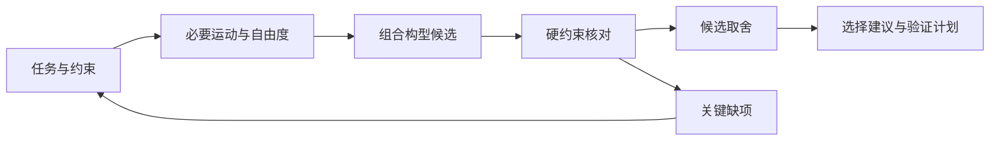

# 机械臂构型选择 Skill 的方案设计思路

版本：1.4.0。面向自研机械臂方案设计人员，接受场景描述或已有方案，形成完整构型候选、比较理由及下一步验证计划。

## 整体逻辑

知识库按任务和设计对象统一组织：构型、自由度、轴系、肘腕、驱动、感知、部署。报告、教材、研究及产品实例均进入同一流程；来源仅作追溯。来源事实、工程推理、具体样机参数和用户输入保留各自的适用范围。

## 从需求到方案

| 环节 | 设计思路 | 形成的记录 |
| --- | --- | --- |
| 1 明确任务 | 把接近、操作、退出、收纳分开，提取载荷、姿态、范围、节拍、精度、接触与安装要求；区分硬约束、偏好和未知 | 需求清单与关键缺项 |
| 2 判断必要运动 | 判断需要哪些独立位置/姿态变化；明确夹爪、工具、外轴和底盘是否参与，不凭行业或轴数标签决定方案 | 任务运动定义、轴数初筛条件 |
| 3 组合候选 | 从机构族开始，组合轴系、肘腕、驱动/电机位置、感知控制与部署；保留用户已有选择及可修改范围 | 候选的完整构型描述 |
| 4 核对硬约束 | 对每项需求记录符合、冲突、未知或不适用；明确冲突才排除，缺资料保持待定 | 逐项约束检查与排除理由 |
| 5 比较取舍 | 在相同任务和数据口径下比较覆盖、冗余、质量/惯量、刚度、控制、维护与成本；按用户偏好讨论优先方向 | 候选比较表及选择条件 |
| 6 安排验证 | 列出能改变选择的关键数据，明确运动学、干涉、负载、驱动、结构、控制和部署需要验证什么 | 推荐方向、待验证项与下游输入 |

完整候选采用：**机构族＋独立自由度/轴系＋肘腕或末端机构＋驱动与质量布置＋感知控制＋部署**。不同维度可以组合，例如“7轴偏置串联＋旋转模组＋关节力矩感知＋固定双臂”；缺项保持未知，不用示例自动补齐。

## 参考库如何支持选择

- **场景表**：帮助定位值得比较的方向，以及哪些条件会改变候选。
- **构型表**：比较机构的运动能力、优势、代价、已有实例、场景与部署。
- **专题表**：细化肘腕、传动、感知、质量布置及部署取舍。
- **案例分析**：保留具体轴系、限位、项目比较和资料疑点，支持进一步核对。
- **验证清单与来源登记**：说明结论支持到哪里，以及还缺哪些工程证据。

综合对照表供完整审阅；日常执行只读取当前任务涉及的专题，减少小上下文模型的负担。不会要求模型一次记住整份资料库。

## 输出与执行边界

默认交付四部分：需求与未知项、候选比较表、条件选择建议、补充信息及验证计划。每个候选标记为列入比较、条件候选、明确冲突或证据不足；这些状态不代表工程验收。

有工具时可在输入充分且任务需要的情况下衔接运动学、静力学、动力学、建模或任务仿真。没有工具时仍可完成需求和条件比较，明确未执行计算；没有参考正文时只能整理需求和缺项。闭链、连续体和绳索张力等需要适配的模型，不直接套串联分析工具。

## 一个直观示例

用户需要桌面取放，工具保持竖直，还需绕竖直轴转动。先按XYZ加一个转动的任务形式，比较XYZ加转轴、SCARA和合适的串联方案；再用范围、工具负载、障碍、节拍和维护要求缩小候选。若必须由机械臂完成翻面，就重新核查倾斜姿态能力，调整候选。7轴是否值得加入，取决于保持位姿调肘、绕障等实际需求。

入口见[SKILL.md](../arm-configuration-selection/SKILL.md)，资料导航见[统一知识库](../arm-configuration-selection/references/knowledge-index.md)，完整审阅见[综合对照表](../arm-configuration-selection/references/selection-tables.md)。
