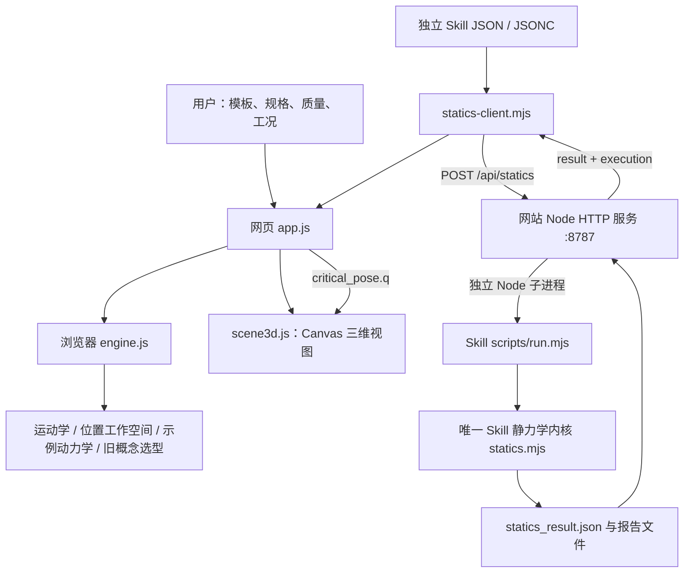
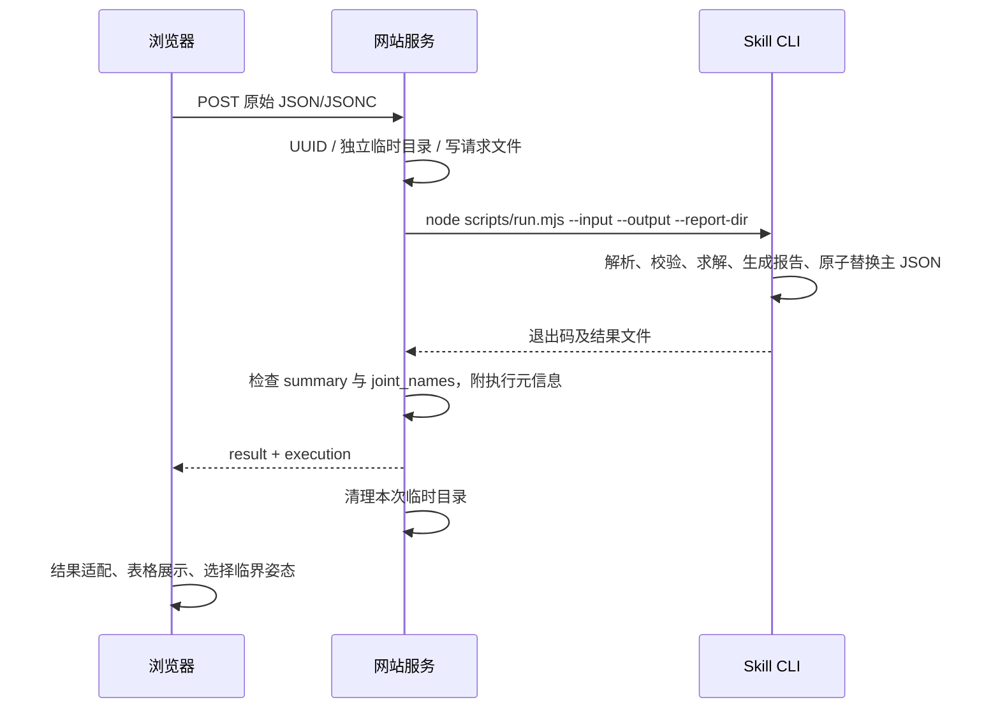

# 机械臂自动设计工具：整体设计与实现说明

编制日期：2026-10-28  
分析对象：当前仓库代码、输入样例、接口与自动化测试。  
文档定位：说明系统做什么、如何实现、数据怎样流转，以及当前实现距离完整自动设计闭环还差什么。历史文档与现有代码冲突时，以现有代码为准。

更新说明：本文主体记录首次梳理时的实现快照。随后完成的安装姿态功能已将 Skill 升至1.1.0、网页内核升至1.4.0，扩展输入契约、重力计算与三维安装显示，并增加模型/输入变化检查；具体实现和验证以[安装姿态与重力配置](安装姿态与重力配置.md)为准。

## 1. 工程定位与总体结论

本工程是一个以七自由度机械臂为主要对象的**参数化概念设计与分析工作台**。用户输入构型、几何、质量、限位、负载和运动条件，系统生成运动学、位置可达空间、静态载荷、示例动力学及关节模组需求，并提供三维观察与结果导出。

当前系统由两个子工程组成：

- **SRS Lab 网页工作台**：负责交互建模、三维展示，以及浏览器内的概念计算。
- **arm-statics-parametric Skill**：负责独立、可复现的参数化静力学校核，既能单独运行，也能由网页后端调用。

工程已经形成“参数输入 → 计算分析 → 需求输出”的主要链路，但还没有形成“目标规格 → 自动生成候选构型 → 自动挑选实际模组 → 回写质量惯量 → 迭代优化”的完整自动设计闭环。

需要特别区分三点：

1. 网页“静力学分析”页使用独立 Skill 的真实计算结果。
2. 网页“运行全流程”执行的是浏览器内的 `SRS.run()`，不会自动运行该 Skill；旧选型模块仍使用网页内核的静态采样结果。
3. “Skill 工作流”页面描述了模块化能力规划；当前仓库实际交付的独立 Skill 只有 `arm-statics-parametric`，不能据页面名称推断其他独立 Skill 已实现。

## 2. 用户流程与功能框架

### 2.1 典型使用流程

1. 选择机械臂模板或导入网页规格 JSON。
2. 编辑轴向、几何、质量、质心、限位及运动参数。
3. 运行网页概念计算，查看位姿、点云、动力学和关节需求。
4. 准备与当前机械臂物理模型一致的 Skill JSON/JSONC，在静力学页独立提交。
5. 查看逐关节静态需求与临界姿态，将对应关节角应用到三维模型。
6. 分别导出网页概念分析结果和 Skill 校核结果。
7. 修改模型后重新计算；后续由工程人员补充真实产品、CAD 参数和实际任务工况。

步骤 3 与步骤 4 当前是两条独立的计算流程，需要人为保证模型一致。

### 2.2 九个页面的职责

| 页面 | 当前功能 | 主要实现与边界 |
|---|---|---|
| 设计总览 | 构型预览、主要规格、点云、静/动态需求概览 | 概览力矩使用网页旧内核，静态值明确标为概念估算 |
| 规格与模型 | 模板、杆长、七段向量、负载、质量分配、轴向、限位、驱动及运动参数编辑；JSON 导入导出 | 质心与惯量还可通过配置 JSON 提供；不是完整 CAD 建模器 |
| 运动学计算 | 正运动学、末端位置与旋转矩阵、6×7 几何雅可比、位置逆解、关节操控 | 逆解只约束位置，没有末端姿态约束 |
| 可达空间 | 固定种子的关节空间采样、法兰位置点云、XYZ 包围盒、最大采样肩距 | 没有碰撞、姿态及驱动载荷过滤 |
| 静力学分析 | 输入 JSON/JSONC、调用真实 Skill、扭矩与需求表、裕量、来源信息、临界姿态预览、JSON 导出 | 网页目前限定七轴结果；Skill 本身支持更多串联关节类型 |
| 动力学分析 | 内置运动周期的力矩时序、峰值、RMS、功率等 | 采用概念惯量与正弦示例，不支持用户任务轨迹导入 |
| 关节模组选型 | 输出侧额定/峰值需求、电机转矩转速、制动保持需求、CSV | 输出规格需求，尚未匹配供应商产品；未消费独立 Skill 的结果 |
| Skill 工作流 | 展示分阶段输入输出与模块职责 | 是能力说明页，没有在线任务编排器 |
| 模型与依据 | 展示计算方法、参数依据、假设和未校核项 | 用于解释适用范围与结果来源 |

## 3. 系统架构



### 3.1 设计取舍

- **确定性计算**：实际力矩由代码计算，语言模型不承担数值求解。
- **交互与计算分离**：网页负责输入和展示，Skill 提供可独立运行的静力学校核能力。
- **避免页面复制校核算法**：静力学页不自行计算或在调用失败时使用旧数值兜底。
- **保留既有功能**：旧网页内核继续服务运动学、动力学和概念选型，因此仓库中仍存在两套用途不同的重力计算实现。
- **低依赖部署**：原生 JavaScript、Node 内置 HTTP 与子进程，无第三方运行依赖，也没有数据库。

“唯一静力学内核”准确地指独立 Skill 校核链路，并不表示整个仓库已经删除所有旧重力公式。

### 3.2 三种运行入口

| 入口 | 实现 | 用途 |
|---|---|---|
| 集成工作台 | `srs-lab-source/server/index.mjs`，默认 8787 | 提供主网站，通过子进程执行 Skill |
| Skill CLI | `arm-statics-parametric/scripts/run.mjs` | 批处理、独立校核、生成完整报告 |
| Skill 参考网页/API | `arm-statics-parametric/scripts/server.mjs`，默认 8765 | 独立示例界面；HTTP 使用 Node Worker 执行计算 |

Skill 还提供浏览器模块 Worker 适配器，可直接调用同一内核。**主工作台当前采用 CLI 桥接，没有采用这一浏览器 Worker 方案。**

## 4. 代码组织与模块职责

```text
armDesignTool/
├─ README.md
├─ docs/工程设计说明.md
├─ srs-lab-source/
│  ├─ dist/                       可直接运行的前端源文件
│  │  ├─ index.html / style.css   页面骨架与样式
│  │  ├─ app.js                  状态、页面模板、交互、结果导出
│  │  ├─ engine.js               七轴概念计算内核
│  │  ├─ scene3d.js              Canvas 三维渲染与关节操控
│  │  ├─ statics-client.mjs      Skill HTTP 客户端与展示适配
│  │  ├─ worksheet-minimal.*     选型表输入示例
│  │  └─ worksheet-critical-poses.js  历史临界姿态快照
│  ├─ server/index.mjs           静态资源服务与 CLI 桥接
│  └─ tests/                     数学回归、页面模板和模拟 API 测试
└─ arm-statics-parametric/
   ├─ SKILL.md / agents/         Skill 使用说明与代理配置
   ├─ scripts/
   │  ├─ lib/statics.mjs         标准化、静力学、搜索、判定、报告
   │  ├─ lib/input-text.mjs      JSON / JSONC 文本解析
   │  ├─ run.mjs                CLI 与文件导出
   │  ├─ server.mjs             独立参考 HTTP 服务
   │  ├─ node-worker.mjs        Node Worker 入口
   │  └─ tests/                 内核、解析、CLI、HTTP 测试
   ├─ assets/examples/          两杆、七轴、左右臂、移动轴等示例
   ├─ assets/web/               参考网页与浏览器 Worker 适配
   └─ references/               坐标契约、JSON Schema、集成及验证说明
```

`dist/` 在当前工程中是受版本管理的直接运行代码；`package.json` 没有构建脚本，仓库也没有另一套 React/Vue/TypeScript 前端源码。修改网页应以这些文件为入口。

## 5. 机械臂模型设计

### 5.1 网页模型

网页固定为七个旋转关节，通过 `config` 描述模板、轴向、几何、质量、限位和分析参数，再由 `SRS.model()` 生成计算模型。

| 模板 ID | J1～J7 局部轴序 | 几何特点 |
|---|---|---|
| `SRS-7R` | Z / Y / X / Y / X / Y / X | 理想肩肘腕模型，零位沿 +X |
| `SRS-7R-XYZ` | X / Y / Z / Y / X / Y / X | 类人肩部近似，侧装底座 |
| `SRS-7R-YZX` | Y / Z / X / Y / X / Y / X | 保留历史模板 |
| `WORKSHEET-7R` | −Y / X / −Z / −Y / −Z / Y / X | 七个分离轴心，零位沿 −Z |

用户可通过 `jointAxes` 覆盖七个局部轴，支持正负坐标轴和任意非零向量。内核归一化轴向，检查非法数值，并提示肩部零位轴线重合；这不构成机械可制造性或独立自由度证明。

普通 SRS 模板采用“绕当前局部轴旋转，再沿局部 X 平移”的链。选型表模板使用逐段 `linkVectors`。

通用模板默认参数为：臂展 600 mm、三段 300/213/87 mm、负载 3 kg、运动自重 8 kg、速度 60°/s、加速度 120°/s²、速比 80、效率 0.75、安全系数 1.5。它们是概念设计初值。

选型表模板采用七段 35/50/250/50/163/47/40 mm，总长度 635 mm，其中 J2 至末端 600 mm；模组质量 2.902 kg、连杆质量 0.710 kg，合计 3.612 kg，负载 3 kg，重力 9.8 m/s²，设计系数 1.2。

### 5.2 网页状态与缓存

- `config`：当前设计参数，计算成功后保存至 `localStorage`。
- `result`：网页旧内核的概念分析结果。
- `q`：当前三维交互姿态，内部单位 rad。
- `dirty`：模型参数修改后置位，要求重新计算。
- `skillInput`：独立 Skill 输入文本。
- `skillData`：Skill 返回结果及展示模型。
- `skillRunSignature`：运行时网页配置快照，用于拒绝配置变化后的旧结果。

改变参数、重新运行网页概念计算或编辑 Skill 输入会使旧 Skill 结果失效。浏览器刷新会恢复网页配置，但不会恢复上一份完整 Skill 结果；后端也不持久化任务历史。

### 5.3 Skill 模型

Skill 的物理模型比网页更通用：

- `standard`：支持 1～64 个串联 revolute、prismatic、fixed 关节。
- `simple`：支持 1～32 个旋转关节，使用连杆参数展开为标准模型。
- 范围搜索最多支持 16 个主动关节。
- 标准模型支持安装平移、RPY 旋转、任意局部轴、逐刚体质量组件和局部质心。
- 负载、附件、外部力与自由力矩可单独表达。

标准模型的关节变换为：

```text
旋转关节：T_parent_child = T_origin · Rot(axis, q)
移动关节：T_parent_child = T_origin · Trans(axis · q)
```

质量组件绑定到所属输出刚体，只影响该刚体及上游主动关节。模组固定端和运动端应分别归属正确刚体。简易输入默认连杆中点质心、模组质量整体放入输出刚体，属于带警告的概念近似。

### 5.4 单位及模型一致性

网页显示 mm、度，计算时转换为 m、rad。Skill 契约统一采用 m、kg、rad、N、N·m；移动关节位移使用 m，不自动猜测或转换单位。

网页配置 JSON 与 Skill 请求 JSON 是两种不同数据格式。当前没有自动转换器，也没有物理模型等价检查。临界姿态能正确显示，需要关节名称与顺序、局部轴、安装变换、零位、几何、限位和载荷模型相互对应。

## 6. 计算方案与实现

### 6.1 运动学及位置逆解

`engine.js` 的 `fk()` 顺序累积旋转和平移，记录关节原点、基坐标轴、刚体质心、末端位置及旋转矩阵。

旋转关节的雅可比列为：

```text
Jv_j = a_j × (p_tip − o_j)
Jω_j = a_j
```

位置 IK 采用阻尼雅可比方法，通过 `Jᵀ(JJᵀ + λI)⁻¹e` 更新角度，限制步长和关节范围，并使用多个初始姿态尝试。默认位置收敛阈值为 0.1 mm；没有求解六维目标位姿。

### 6.2 工作空间

`sample()` 在限位内按固定种子采样，求各姿态法兰位置，输出点云、包围盒及最大采样肩距，同时计算旧重力采样包络。网页允许 100～50,000 个样本。

这是一种位置采样估计，不能直接当作完整边界或带载、无碰撞的任务工作空间。

### 6.3 独立静力学校核

`statics.mjs` 先标准化输入，再将重力、负载、附件和外力统一变换到基坐标系。对作用点 p、关节原点 o、关节轴 a，有：

```text
旋转关节保持力矩：τ = −a · [(p − o) × F + M]
移动关节保持力：  f = −a · F
```

对全部有效部件叠加即可得到保持载荷。输出既保留带符号值，又按 robot、payload、attachments、external 分类保留贡献。

搜索过程为：

1. 检查给定姿态，以及关节范围中点、全部下限组合和全部上限组合。
2. 固定 PRNG 种子生成范围内随机姿态。
3. 为每个关节维护最大绝对载荷的精英候选。
4. 以固定顺序、固定预算进行坐标细化。
5. 输出各关节最大已检查载荷及其完整临界姿态。

搜索允许 1～200,000 个随机样本，默认精英数 3、细化轮数 8，并限制预估计算预算。各关节临界姿态可能不同；搜索不证明全局最大，也不排除碰撞姿态。

### 6.4 静态驱动需求与判定

```text
required_output = max_abs_checked × design_factor
motor_static_torque = required_output / (ratio × efficiency)
margin = continuous_available / required_output − 1
```

设计系数只乘一次。没有容量或需求为零时，裕量为 `null`。

| 状态 | 含义 |
|---|---|
| `not_sized` | 未提供连续能力，完成载荷计算但不能判定选型 |
| `exceeds_capacity` | 已检查需求超过能力 |
| `capacity_conditions_unknown` | 数值能力足够，连续工作适用条件未说明 |
| `satisfies_checked_cases` | 在声明条件下满足已检查工况 |

移动关节输出单位为 N，但当前没有丝杠或直线驱动换算。静态能力不能直接证明长期热保持、抱闸或寿命满足。

### 6.5 网页动力学

网页内核通过各刚体质心雅可比和估计惯量构造质量矩阵：

```text
M(q) = Σ[m JvᵀJv + Jωᵀ R I Rᵀ Jω]
τ = Mq̈ + Cq̇ + G + Bq̇ + τc sign(q̇)
```

科氏/离心项通过质量矩阵中心差分与 Christoffel 系数组合求得。默认惯量采用杆/球等近似，可由用户提供局部对角主惯量替换，不是任意完整惯量张量导入。

内置工况采用 64 点正弦关节周期，结合速度、加速度上限选取频率，输出峰值、RMS、速度、加速度和功率。RMS 包含非运动时间的中心姿态保持。当前没有真实任务轨迹、减速器惯量或专业动力学求解器交叉验证流程。

### 6.6 网页旧概念选型

```text
输出峰值 = K × max(旧静态采样峰值, 动态峰值)
输出额定 = K × max(周期 RMS, 中心姿态保持力矩绝对值)
电机转矩 = 输出需求 / (iη) + K × Jrotor × i × αmax
电机最高转速 = i × ωmax × 60 / (2π)
电机侧制动保持需求 = K × 旧静态采样峰值 / i
```

功率列使用峰值转矩与最高转速的乘积包络，不能解释为额定功率。该模块不搜索速比、不查产品目录，也不会自动用 Skill 的搜索峰值替换旧静态采样值。

## 7. 网页与 Skill 接口设计

### 7.1 请求与返回

```text
GET  /api/statics/health
POST /api/statics
Content-Type: application/json 或 application/jsonc
Body: Skill 原始请求文本，最大 2 MiB
```

Skill 请求核心字段：

| 字段 | 内容 |
|---|---|
| `schema_version` | 当前为 `1.0` |
| `input_mode` | `standard` 或 `simple` |
| `model` / `simple` | 对应输入模式的机械臂定义 |
| `gravity_m_s2` | 显式基坐标系重力向量 |
| `payload` | 质量及 tip 坐标系下质心；无负载也显式给零质量 |
| `poses` | 全部主动关节名称到角度/位移的映射 |
| `search` | 样本数、种子及可选细化参数 |
| `attachments` / `wrenches` | 可选附件和已知外载 |
| `drives` / `design_factor` | 可选驱动能力、传动参数及设计系数 |
| `metadata` | 来源与估算说明 |

`poses` 和 `search` 至少提供一个。JSONC 支持注释和 BOM，不支持尾逗号。Schema 提供契约描述，实际计算前由内核执行字段、引用、数值及预算校验；网站桥接层没有另外加载 Schema 验证器。

成功返回结构：

```json
{
  "ok": true,
  "result": {
    "schema_version": "1.0",
    "engine_version": "1.0.0",
    "joint_names": ["J1", "J2", "J3", "J4", "J5", "J6", "J7"],
    "summary": [],
    "poses": [],
    "search": {},
    "warnings": []
  },
  "execution": {
    "request_id": "运行 UUID",
    "execution_mode": "skill_cli",
    "elapsed_ms": 0,
    "executed_at": "ISO 时间",
    "raw_input_sha256": "原始文本哈希",
    "input_sha256": "规范键序的输入对象哈希"
  }
}
```

以上为结构示意，真实 `result` 还包含输入快照、标准化内部模型、哈希与 scope。核心输出不含时钟和随机 ID，运行时间与 ID 由桥接层另行附加。

### 7.2 服务端执行时序



子进程使用参数数组启动，不经 shell 拼接。默认 120 秒超时；每次请求使用不同目录，避免结果文件混用。服务读取完整结果后清理临时目录，配套报告不会在服务器长期保留。

### 7.3 三维姿态应用

客户端检查 `execution_mode === 'skill_cli'`，通过 `makeStaticsViewModel()` 转换结果，再使用 `poseToJointAngles()` 读取完整关节角。主页面要求七个关节，并按当前网页限位检查后赋值给共享 `q`。

这里有两项尚未覆盖的契约检查：

- 七个关节的数量与角度合法，不等于名称、顺序和关节类型均与网页匹配；当前最终仍按 Skill 返回顺序赋值。
- 网页配置签名不能证明上传的 Skill 模型与网页物理模型一致。

此外，运行中的配置变化有签名检查；运行中仅修改 Skill 输入文本的情况，没有独立输入版本签名校验，后续适合补充请求序号或输入哈希来避免旧请求覆盖新输入状态。

### 7.4 错误行为与两套服务的区别

主网站桥接层：未配置返回 503；不支持的内容类型返回 415；空输入等桥接输入错误按 400 处理；CLI 失败、超时、结果错误统一对外返回 502 / `SKILL_EXECUTION_FAILED`。详细原因记录在服务日志中。超大请求会销毁连接，不能保证客户端收到完整 JSON 错误。

Skill 参考服务则提供更细的 400/413/415/422/503/408 等错误状态，最多两个并发 Worker、1 MiB 输入限制，并仅监听回环地址。**这些限制没有自动继承到主网站桥接服务。**

## 8. 三维展示方案

`scene3d.js` 使用原生 Canvas 2D 绘制透视投影的三维网格，通过深度排序呈现关节、连杆、底座、夹爪、坐标轴和点云，没有 Three.js/WebGL 依赖。

支持相机旋转、滚轮缩放、关节选择、拖动关节与旋转环、滑块及键盘微调。旋转环通过鼠标射线与关节转动平面交点求角度，操作受限位约束。

普通 SRS 模型为便于观察，在肩和腕增加展示间距，其显示几何不同于理想计算几何。选型表模板存在 `linkVectors` 时，展示直接采用计算 FK，七个轴心位置一致。两种展示策略需要保留清晰提示。

历史文件 `worksheet-critical-poses.js` 仍被 HTML 加载，但当前静力学结果表与临界姿态选择来自本次 Skill 返回，不读取该历史快照作为校核结果。

## 9. 结果导出与可追溯性

| 出口 | 交付物 | 当前内容 |
|---|---|---|
| 网页总导出 | `srs-design-results.json`、规格 CSV、可打印 HTML、规格输入 JSON | 网页概念内核结果，未合并独立 Skill 结果 |
| 静力学页 | `statics_result.json` | 原始 Skill `result`，包含模型、输入哈希、搜索及判定 |
| Skill CLI | 主 JSON、`joint_summary.csv`、`report.md`、`normalized_model.json`、`standard_request.json` | 完整独立校核交付 |

`normalized_input` 是内部快照，不能当作原始请求重新提交；复算应使用原始 `input_snapshot` 或 `toStandardInput()` / `standard_request.json`。

CLI 在计算与配套导出完成后原子替换主 JSON；配套文件逐个原子替换，不是整个报告目录的事务。失败时旧文件可能仍存在，必须检查退出码。

目前网页下载的 Skill JSON 不含外层 `execution`，因此运行 UUID、执行时间等仅显示在页面及服务日志中。若需要完整审计，应同时保存请求、结果和 execution，并记录实际 Skill 代码版本。

## 10. 运行与维护

完整工程采用 Node.js ≥20；本次验证环境为 Node.js v24.22.1。无需先安装 npm 依赖。

```powershell
cd E:\Robot\armDesignTool\srs-lab-source
$env:STATICS_SKILL_DIR = 'E:\Robot\armDesignTool\arm-statics-parametric'
npm.cmd start
```

访问：`http://localhost:8787/?model=worksheet#statics`。

| 配置项 | 默认/作用 |
|---|---|
| `STATICS_SKILL_DIR` | 必须显式设置；Skill 所在目录 |
| `PORT` | 8787 |
| `STATICS_TIMEOUT_MS` | 120000 ms |
| `WEB_ORIGIN` | 空，默认不附跨域允许头；设置后指定响应允许的 Origin |

健康检查只判断路径环境变量是否非空，不检查入口存在或是否能计算。主网站 `listen(PORT)` 未显式限定回环接口，不能把它理解成强制仅本机可访问的服务。

维护入口建议：网页交互改 `app.js`；概念计算改 `engine.js`；三维改 `scene3d.js`；独立校核算法改 `statics.mjs`；桥接与任务生命周期改网站 `server/index.mjs`。修改数据契约时同步检查客户端适配和测试。

## 11. 本次验证结果

验证日期：2026-10-28。以下为本次实际执行记录，区别于仓库历史说明。

| 验证项 | 结果 | 证明范围 |
|---|---|---|
| 网页 `npm.cmd test` | 9 项通过，0 失败 | 数学回归、构型、自定义轴、选型表夹具、页面模板、模拟 CLI 桥接 |
| Skill `node --test scripts/tests/*.test.mjs` | 60 项通过，0 失败 | 解析力矩、势能差分、搜索复现、输入拒绝、驱动判定、JSONC、CLI、参考 HTTP Worker |
| 主网站后端 → 真实 Skill → 结果返回 | 通过 | 使用真实选型表输入；返回 result 与同输入直接 `analyze()` 深度完全相等 |
| 七个临界姿态单点复算 | 通过 | 各关节在其临界姿态处的绝对载荷与 summary 一致，误差小于 1e-9 |
| 七个临界姿态与网页重力内核对照 | 通过 | 同一选型表物理模型，各姿态全部关节载荷最大差约 4.68e-16 N·m |
| 真实浏览器视觉与完整交互 | 本次未执行 | 模板测试和 HTTP 验证不能代替浏览器验收 |

网页测试运行器报告的 9 项包含多个内部断言，不表示只校验了 9 条数学性质。选型表原回归测试读取固定夹具，本次另做的真实桥接与单点复算补充了实际内核调用验证。

### 11.1 真实选型表示例结果

输入：`assets/examples/worksheet-minimal.json`；搜索 20,000 样本、seed=42，实际求值 24,730 次；内核版本 1.0.0；设计系数 1.2。

| 关节 | 最大已检查绝对力矩 / N·m | 设计输出侧需求 / N·m | 状态 |
|---|---:|---:|---|
| J1 | 25.192527 | 30.231032 | not_sized |
| J2 | 23.271384 | 27.925661 | not_sized |
| J3 | 10.077630 | 12.093156 | not_sized |
| J4 | 10.077644 | 12.093173 | not_sized |
| J5 | 2.676762 | 3.212115 | not_sized |
| J6 | 2.676762 | 3.212115 | not_sized |
| J7 | 1.185800 | 1.422960 | not_sized |

输入对象 SHA-256：`a2777c6207c88c1dfa162ffbb8233eb852b02cd972540a7b1a57987637e40cb0`。

全部为 `not_sized`，因为该输入没有提供连续驱动能力。数值说明该模型的已检查载荷与需求，不表示具体模组选型已通过。

## 12. 当前差距与建议设计演进

### 12.1 优先闭合模型与结果链路

| 优先级 | 建议 | 目的与验收标准 |
|---|---|---|
| P0 | 建立统一物理模型及明确的网页 → Skill 转换 | 同一模型携带轴、安装、几何、质量归属、COM、限位和单位；转换结果可复算，缺参数显式提示 |
| P0 | 将 Skill 静态结果接入选型数据契约 | 选型显式消费同模型版本的静态结果与动态结果，拒绝快照错配，避免只更新静力页 |
| P0 | 严格校验预览模型及请求版本 | 核对关节名称、类型、顺序与模型哈希；新输入产生新请求序号，过期响应不能覆盖当前状态 |
| P0 | 展示完整判定并统一导出 | 静力页显式显示 `status`；统一报告包含两条计算来源、输入、模型版本和执行元信息 |
| P1 | 添加目标浏览器端到端验收 | 验证导入、计算、失效、错误提示、临界姿态和导出；覆盖几何对应及关节操控 |

当前客户端保留了 `status` 字段，但静力学表格未独立显示该判定，数值裕量也没有直接展示连续能力适用条件；适合与报告统一一并改进。

### 12.2 补齐工程分析能力

1. 引入 CAD/实测质量、真实质心和完整惯量，明确固定端/运动端及工具质量归属。
2. 增加六维姿态 IK、碰撞与自碰撞检查，形成任务相关的有效可达空间。
3. 接入实际任务轨迹，计算周期 RMS、转矩转速包络、热保持及减速器/电机惯量。
4. 接入供应商目录，基于能力条件、速比、制动、寿命、刚度和轴承载荷筛选真实产品。
5. 将候选模组质量与惯量回写模型，迭代分析，最后再开展多构型与参数优化。

以上均为建议方案，当前仓库未实现这些完整能力。

### 12.3 如需服务化

现有 CLI 桥接适合本地集成。多人使用时，可在其上增加任务 ID、状态查询、队列、并发与资源限制、取消机制、持久化及鉴权。当前主桥接层没有这些能力；浏览器断开请求也没有显式联动终止 CLI。

主桥接层与 Skill 参考服务已经有不同的错误契约和资源限制，服务化前应统一。不要将参考服务的双 Worker 限制误认为主工作台已经具备的调度能力。

## 13. 版本与历史说明

| 标识 | 当前代码情况 |
|---|---|
| 网站集成文档 | 使用 V10 / V11 叙述集成与临界姿态功能 |
| 网站 package.json | `srs-lab-v10` / `10.0.0` |
| 网页计算内核 | 导出 `version = '1.3.0'`，文件顶部仍有旧 v1.2 注释 |
| Skill 内核 | `ENGINE_VERSION = '1.0.0'` |
| 数据契约 | 网页与 Skill 各有 schema_version 1.0，但请求结构不同 |

历史 `srs-lab-source/DESIGN.md` 中“七个独立 Skill”和“尚无网页调度链路”属于早期方案，不能直接作为当前实现说明。现有网站已接通静力学 CLI，但其他模块仍主要在浏览器内执行。根 README 中的示例目录 `E:\Robot\designTool` 也与本机实际 `E:\Robot\armDesignTool` 不同。

后续建议使用独立的应用版本、内核版本、模型版本与 Schema 版本，并在交付记录中同时记录提交号；当前版本字符串本身不足以唯一定位代码快照。

## 14. 实现依据索引

- [网页页面、状态、计算与导出](../srs-lab-source/dist/app.js)
- [网页计算内核与四种模板](../srs-lab-source/dist/engine.js)
- [三维渲染与展示 FK](../srs-lab-source/dist/scene3d.js)
- [Skill 客户端与结果适配](../srs-lab-source/dist/statics-client.mjs)
- [网站 HTTP 与 CLI 桥接](../srs-lab-source/server/index.mjs)
- [独立静力学内核](../arm-statics-parametric/scripts/lib/statics.mjs)
- [CLI 与原子文件导出](../arm-statics-parametric/scripts/run.mjs)
- [Skill 输入与坐标契约](../arm-statics-parametric/references/input-contract.md)
- [Skill 集成说明](../arm-statics-parametric/references/web-integration.md)
- [网站测试](../srs-lab-source/tests/)
- [Skill 测试](../arm-statics-parametric/scripts/tests/)
